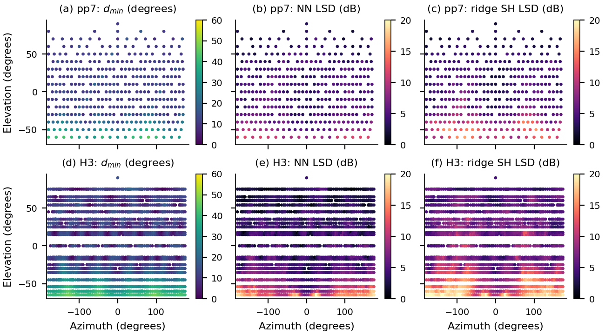
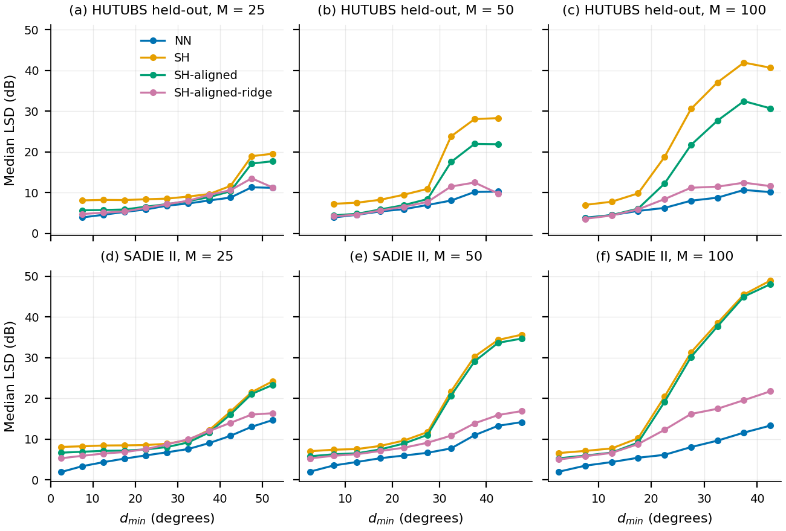
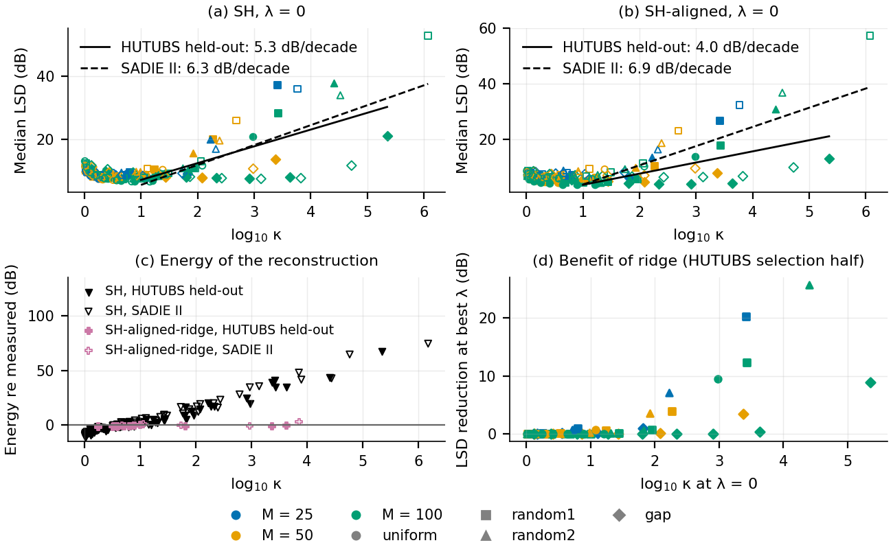

# Predicting Sparse HRTF Reconstruction Error from Sampling Geometry

**Coverage, conditioning and transfer from HUTUBS to SADIE II**

Fanxing Ning, SID 540084782. ELEC5305 Speech and Audio Processing, The University of Sydney.

[Final report (PDF)](report/report.pdf) | [Video presentation](https://ningfanxing-sys.github.io/elec5305-project-540084782/video/) | [Binaural listening examples](https://ningfanxing-sys.github.io/elec5305-project-540084782/demo/) | [Project site](https://ningfanxing-sys.github.io/elec5305-project-540084782/) | [Project proposal](ELEC5305_Project_Proposal.pdf)

## Summary

Head-related transfer functions (HRTFs) describe how the head and ears filter sound from each direction. Binaural rendering needs them on a dense set of directions, but measuring hundreds of directions per listener is slow, so dense sets are reconstructed from sparse measurements.

This project studies the sparse layout itself. Each layout is described by three quantities that are known before any measurement:

- the distance $d_{\min}$ from each target direction to its nearest measured direction;
- the covering radius $r_{\max}$, the largest such distance;
- the condition number $\kappa$ of the spherical-harmonic (SH) fit.

The same nominal layouts of 25, 50 and 100 directions were realised on the measured grids of HUTUBS and SADIE II and reconstructed with nearest neighbour (NN), SH, time-aligned SH and ridge-regularised time-aligned SH, with SUpDEq magnitude-corrected interpolation (MCA) as a published reference. The reconstruction orders and ridge parameters were selected on half of HUTUBS and frozen before SADIE II was evaluated.

## Research question

To what extent do the coverage and SH conditioning of a sparse measurement layout predict the error of sparse-to-dense HRTF reconstruction, and which of these relationships transfer from HUTUBS to SADIE II? A secondary question asks how time alignment and magnitude correction change the relationship between sampling geometry and error.

## Main results

- Coverage predicts where errors are large: adding $d_{\min}$ and its square to the number of directions raises the explained per-target error variance on HUTUBS from at most 7% to 24–47%. For NN and SH, the medians of the two databases agree within 0.5 dB in every 5° distance bin from 5° to 30°.
- The covering radius ranks the worst targets: its rank correlation with the 95th-percentile error is 0.95–0.96 for NN in both databases.
- Above κ ≈ 10 the error of unregularised SH grows by 5–6 dB per decade of κ and the reconstruction gains energy; ridge regularisation with λ = 0.01–0.1 removes almost all of this excess.
- Every relationship keeps its sign on SADIE II, and HUTUBS-fitted models explain 51% (NN) and 32% (SH) of the SADIE II error variance without refitting. Three slopes change by 11–19% and the time-aligned κ slope by 72%, so the form of each relationship transfers while its slope is refitted for each database.
- Time alignment lowers the ITD error on HUTUBS from 79 µs (NN) to 14 µs but helps much less on SADIE II, whose onset estimates are about four times rougher; smoothing the onsets lowers the SADIE II ITD error from 43 to 31 µs.
- Magnitude correction (MCA) gives the lowest error on HUTUBS (3.90 dB), comes within 0.21 dB of NN on SADIE II and lowers the contralateral error by 2.1 dB (HUTUBS) and 4.4 dB (SADIE II).



*Gap layout with 50 directions on HUTUBS pp7 (top) and SADIE II H3 (bottom): distance to the nearest measured direction, NN error and SH-aligned-ridge error. Crosses mark the measured directions.*



*Median error against $d_{\min}$; solid: HUTUBS held-out, dashed: SADIE II.*



*Error and reconstruction energy against κ, and the benefit of ridge regularisation.*

## Listening examples and video

Pink-noise bursts step around the listener on the horizontal plane, rendered with the measured HRIRs and with each reconstruction (HUTUBS pp7 and SADIE II H3, uniform layouts with 25 and 50 directions). Use headphones.

- Listening page: https://ningfanxing-sys.github.io/elec5305-project-540084782/demo/
- WAV files: [`demo/audio/`](demo/audio)
- Video presentation: https://ningfanxing-sys.github.io/elec5305-project-540084782/video/

## Reproduce

The code needs Python 3.12 with the packages in `requirements.txt`; the SUpDEq reference also needs MATLAB with the Signal Processing Toolbox, [SUpDEq](https://github.com/AudioGroupCologne/SUpDEq) at commit 877401f in `external/SUpDEq`, and the `.m` files of Slaney's [Auditory Toolbox](https://engineering.purdue.edu/~malcolm/interval/1998-010/) in `external/AuditoryToolbox/`.

The data are the measured HUTUBS HRIRs ([doi:10.14279/depositonce-8487](https://doi.org/10.14279/depositonce-8487), 94 sets) and SADIE II version 2-2 ([Zenodo record 12092466](https://zenodo.org/records/12092466), 18 human subjects, 44.1 kHz, 256-tap HRIRs). `data/manifest.csv` lists the source URL and SHA-256 of every file.

The download is about 500 MB, the Python steps take about 20 minutes on a laptop CPU (Apple M2) and SUpDEq takes a few minutes.

```bash
pip install -r requirements.txt
python download_data.py       # HUTUBS and SADIE II; SHA-256 per file in data/manifest.csv
python -m pytest -q           # SH orthonormality, SH round trip, one-to-one mapping
python check_data.py          # coordinate and ear-order check, onset rule, elevation limit
python make_layouts.py        # nominal layouts, mapping and geometry table
python select_config.py       # HUTUBS selection half -> results/frozen_config.json
python evaluate.py            # frozen configuration on HUTUBS held-out and SADIE II (+ follow-up)
python transfer.py            # slope and ranking comparison -> results/transfer.csv
python predict.py             # variance explained by M, d_min and kappa
git clone https://github.com/AudioGroupCologne/SUpDEq external/SUpDEq && git -C external/SUpDEq checkout 877401f
python mca.py export && matlab -batch run_supdeq && python mca.py score
python timing.py              # run time of the Python methods
python tables.py              # numbers behind the report's tables
python plot_results.py        # result figures (vector PDF in figures/pdf)
python demo.py                # listening examples and horizontal-plane figure
```

`results/eval_targets.csv.gz` (per-target errors, about 110 MB) and the SUpDEq `.mat` files are regenerated by the scripts and are not committed.

## Repository

| File | Purpose |
|---|---|
| `sofa.py` | SOFA reading, subject lists, evaluated region |
| `sphere.py` | Coordinates, distances, nominal layouts, one-to-one mapping, Voronoi weights |
| `sh.py` | Real SH basis, weighted ridge least squares, singular values, order rules |
| `align.py` | Onset (time-of-arrival) estimate and delay removal |
| `metrics.py` | HRTF spectra, LSD (per ear and averaged), ITD, ILD |
| `reconstruct.py` | NN and SH reconstruction shared by selection and evaluation |
| `select_config.py`, `evaluate.py` | Selection and freeze; evaluation of the frozen configuration |
| `transfer.py`, `predict.py`, `tables.py` | Slope comparison, variance explained, report tables |
| `mca.py`, `run_supdeq.m` | SUpDEq OBTA and MCA reference (with timing) |
| `timing.py` | Run time of the Python methods |
| `check_data.py`, `make_layouts.py`, `plot_results.py`, `figstyle.py` | Data checks and figures |
| `demo.py`, `demo/` | Binaural listening examples and their web page |
| `download_data.py`, `data/manifest.csv` | Data download and checksums |
| `tests/` | Unit tests |
| `report/` | LaTeX source and PDF of the final report |
| `video/` | Video presentation |

## References

1. Arend, J. M., Pörschmann, C., Weinzierl, S. & Brinkmann, F. Magnitude-corrected and time-aligned interpolation of head-related transfer functions. *IEEE/ACM TASLP* **31**, 3783–3799 (2023). https://doi.org/10.1109/TASLP.2023.3313908
2. Arend, J. M., Brinkmann, F. & Pörschmann, C. Assessing spherical harmonics interpolation of time-aligned head-related transfer functions. *J. Audio Eng. Soc.* **69**, 104–117 (2021). https://doi.org/10.17743/jaes.2020.0070
3. Bau, D., Arend, J. M. & Pörschmann, C. Estimation of the optimal spherical harmonics order for the interpolation of head-related transfer functions sampled on sparse irregular grids. *Front. Signal Process.* **2**, 884541 (2022). https://doi.org/10.3389/frsip.2022.884541
4. Ben-Hur, Z., Alon, D. L., Mehra, R. & Rafaely, B. Efficient representation and sparse sampling of head-related transfer functions using phase-correction based on ear alignment. *IEEE/ACM TASLP* **27**, 2249–2262 (2019). https://doi.org/10.1109/TASLP.2019.2945479
5. Zotkin, D. N., Duraiswami, R. & Gumerov, N. A. Regularized HRTF fitting using spherical harmonics. *IEEE WASPAA*, 257–260 (2009). https://doi.org/10.1109/ASPAA.2009.5346521
6. Thuillier, E., Jin, C. T. & Välimäki, V. HRTF interpolation using a spherical neural process meta-learner. *IEEE/ACM TASLP* **32**, 1790–1802 (2024). https://doi.org/10.1109/TASLP.2024.3361377
7. Brinkmann, F. *et al.* A cross-evaluated database of measured and simulated HRTFs including 3D head meshes, anthropometric features, and headphone impulse responses. *J. Audio Eng. Soc.* **67**, 705–718 (2019). https://doi.org/10.17743/jaes.2019.0024
8. Armstrong, C., Thresh, L., Murphy, D. & Kearney, G. A perceptual evaluation of individual and non-individual HRTFs: a case study of the SADIE II database. *Appl. Sci.* **8**, 2029 (2018). https://doi.org/10.3390/app8112029
9. AudioGroupCologne. *SUpDEq: Spatial Upsampling by Directional Equalization*, MATLAB toolbox, commit 877401f (2025). https://github.com/AudioGroupCologne/SUpDEq

The full reference list is in the report.

## AI use acknowledgement

AI was involved in preparing this report, mainly for language polishing, code generation and implementation, and the integration of ideas.
