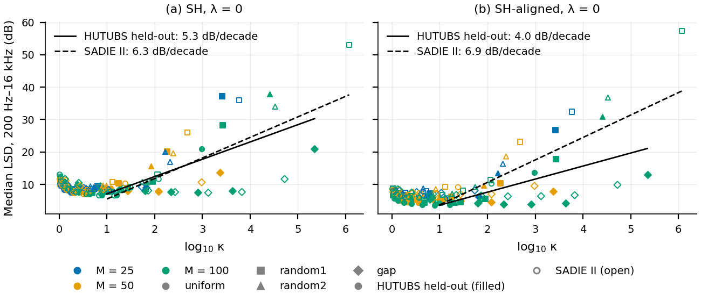
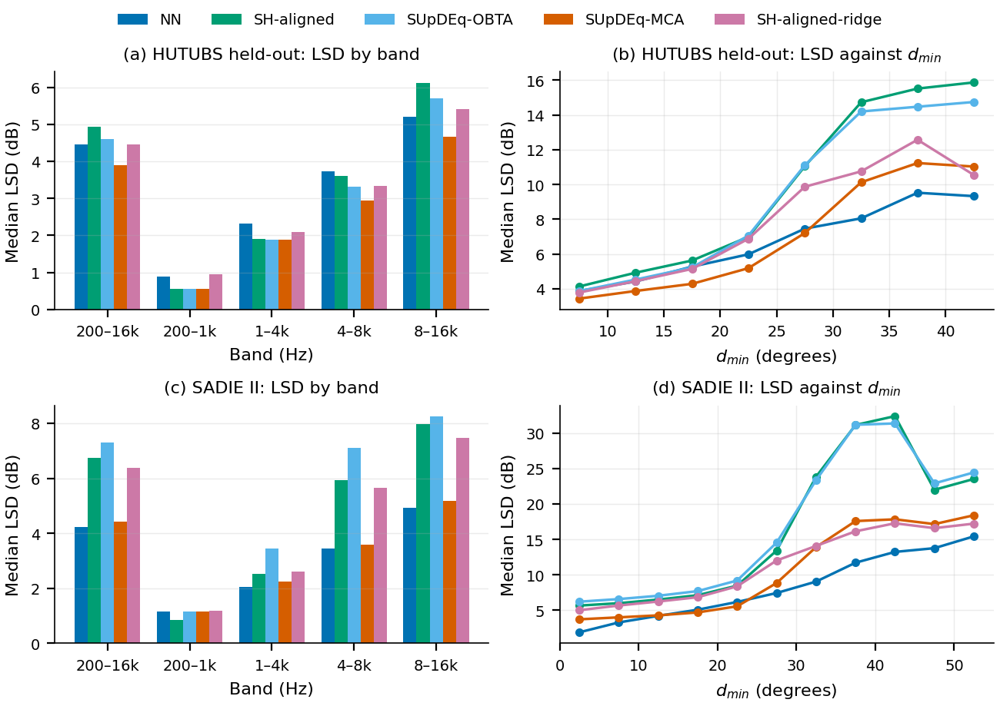

# Sparse-to-Dense HRTF Reconstruction

**Predicting where reconstruction fails: sampling geometry, conditioning and transfer from HUTUBS to SADIE II**

FAXNXING NING  
SID: 540084782  

[Report (PDF)](report/report.pdf) | [Project proposal](ELEC5305_Project_Proposal.pdf) | [GitHub repository](https://github.com/ningfanxing-sys/elec5305-project-540084782) | [Project site](https://ningfanxing-sys.github.io/elec5305-project-540084782/)

## Project summary

Head-related transfer functions (HRTFs) describe how the head and ears filter sound arriving from different directions. They are central to binaural audio, but measuring a dense set of directions for each listener is slow and requires specialist equipment, so practical systems reconstruct dense sets from sparse measurements.

This project asks whether the failure of sparse-to-dense reconstruction can be predicted from the sparse sampling layout itself. The same nominal layouts of 25, 50 and 100 directions were realised on the measured grids of HUTUBS [10, 11] and SADIE II [12, 13]. Each layout was then reconstructed with five methods:

- nearest-neighbour (NN) interpolation;
- spherical-harmonic (SH) interpolation [1];
- time-aligned SH [3, 4];
- ridge-regularised time-aligned SH [14];
- SUpDEq magnitude-corrected interpolation (MCA) [5, 6, 7], as an external reference.

Reconstruction error was related to the conditioning of the SH fit and to the distance between each target and its nearest measured context direction. Parameters were selected on half of HUTUBS and frozen. They were then applied unchanged to the other half and to all 18 human subjects of SADIE II, an independently measured database with a different measurement chain [9].

## Research question

Can the failure of sparse-to-dense HRTF reconstruction be predicted from the geometry and numerical conditioning of the sparse sampling set, and does that relationship hold when moving from HUTUBS to SADIE II? A secondary question is whether time alignment makes reconstruction less sensitive to poor sampling geometry.

## Study design

| Component | Implementation |
|---|---|
| Data | Measured HRIRs from HUTUBS (94 sets, 440 directions) and SADIE II v2-2 (18 human subjects, 2818 or 2114 directions), 44.1 kHz, elevations ≥ −65° |
| Sparse layouts | Nominal uniform, random and gap layouts of 25, 50 and 100 directions, mapped one-to-one onto each measured grid |
| Geometry descriptors | Mapping error, covering radius, nearest-neighbour spacing, distance to the nearest context direction, SH condition number κ |
| Methods | NN, SH, time-aligned SH, ridge-regularised time-aligned SH, SUpDEq OBTA and MCA |
| Evaluation | Log-spectral distortion (broadband and four bands), ITD error, ILD error, reconstruction energy |
| Validation | Selection on 49 HUTUBS sets, freeze, then held-out HUTUBS (45 sets) and SADIE II (18 subjects) |

## Results

- **Local coverage.** In both databases, the error grows with the distance from a target to its nearest context direction. For NN, the two databases agree within 0.5 dB at every distance up to 30°.
- **Prediction.** The context budget alone explains at most 7% of the per-target error variance. Models that add this distance explain 24–47%.
- **Worst case.** The covering radius predicts the 95th-percentile error (rank correlation 0.95–0.96 for NN in both databases).
- **Conditioning and regularisation.**
  - Above κ ≈ 10, the error of ordinary SH rises by 5–6 dB per decade of κ.
  - Ridge regularisation removes most of this rise: at the highest order, the excess error falls from 8.7 dB to 0.6 dB.
  - Wherever ridge helps by more than 0.1 dB, the preferred λ is 10⁻² or 10⁻¹.
- **Transfer.** In SADIE II the relationships keep their sign, and three of the four fitted slopes lie within 11–19% of their HUTUBS values. The exception is time-aligned SH, whose κ slope is 72% steeper.
- **Time alignment.**
  - On HUTUBS, alignment lowers the ITD error from 79 µs (NN) to 14 µs.
  - On SADIE II it helps much less, and its onset estimates are nearly four times rougher across directions.
- **Magnitude correction.** On the SUpDEq subset, MCA gives the lowest broadband error on HUTUBS (3.90 dB) and stays within 0.21 dB of NN on SADIE II.


*Median LSD against distance to the nearest context direction for HUTUBS held-out (a–c) and SADIE II (d–f).*



*LSD against log10 κ for ordinary and time-aligned SH. Filled: HUTUBS held-out; open: SADIE II.*



*SUpDEq subset: LSD by band and LSD against distance to the nearest context direction, with NN for comparison.*

The full method, all results and the discussion are in the [report](report/report.pdf).

## Course relevance and feasibility

The work applies Fourier-domain filtering, correlation-based delay estimation, spectral analysis, spatial sampling, least-squares estimation with regularisation and binaural cue analysis from ELEC5305. The core experiments run in Python on a Mac CPU using public data. The SUpDEq reference runs in MATLAB. No new measurements, GPU or listening experiment were needed.

A small set of modules provides SOFA reading, layout mapping, the SH basis, time alignment and the error measures, and unit tests check the SH basis and the layout mapping. The MCA reference runs in SUpDEq.

## Outputs

- Reproducible Python code with unit tests, plus a MATLAB script for the SUpDEq reference
- A data manifest with a SHA-256 checksum for every downloaded file
- The frozen configuration ([`results/frozen_config.json`](results/frozen_config.json))
- Machine-readable results in [`results/`](results), including [`transfer.csv`](results/transfer.csv) and [`prediction.csv`](results/prediction.csv)
- Figures in [`figures/`](figures), with vector versions in `figures/pdf/`
- The written report in LaTeX ([`report/report.tex`](report/report.tex), [`report/report.pdf`](report/report.pdf))

## Reproduce

**Requirements.**

- Python 3.12 with the packages in `requirements.txt`.
- The SUpDEq reference additionally needs:
  - MATLAB with the Signal Processing Toolbox;
  - [SUpDEq](https://github.com/AudioGroupCologne/SUpDEq), commit 877401f;
  - the [Auditory Toolbox](https://engineering.purdue.edu/~malcolm/interval/1998-010/) `.m` files in `external/AuditoryToolbox/`.

**Runtime.** The data download is about 350 MB. The Python steps take about 15 minutes on a laptop CPU.

```bash
pip install -r requirements.txt
python download_data.py       # HUTUBS and SADIE II, checksums in data/manifest.csv
python -m pytest -q           # SH orthonormality, SH round trip, one-to-one mapping
python check_data.py          # coordinate validation and onset checks
python make_layouts.py        # nominal layouts, mapping and geometry table
python select_config.py       # HUTUBS selection half -> results/frozen_config.json
python evaluate.py            # frozen configuration on HUTUBS held-out and SADIE II
python transfer.py            # slope comparison -> results/transfer.csv
python predict.py             # variance explained by M, d_min and kappa
git clone https://github.com/AudioGroupCologne/SUpDEq external/SUpDEq && git -C external/SUpDEq checkout 877401f
python mca.py export && matlab -batch run_supdeq && python mca.py score
python plot_results.py        # result figures
```

`results/eval_targets.csv.gz` (per-target errors, 83 MB) is regenerated by `evaluate.py` and is not committed.

## Repository

| File | Purpose |
|---|---|
| `sofa.py` | SOFA reading, subject lists, evaluated region |
| `sphere.py` | Coordinates, distances, nominal layouts, one-to-one mapping, Voronoi weights |
| `sh.py` | Real SH basis, weighted ridge least squares, singular values, order rules |
| `align.py` | Time-of-arrival estimate and delay removal |
| `metrics.py` | HRTF spectra, LSD, ITD, ILD |
| `reconstruct.py` | NN and SH reconstruction shared by selection and evaluation |
| `select_config.py`, `evaluate.py`, `transfer.py`, `predict.py` | Selection and freeze, evaluation, slope comparison, variance explained |
| `mca.py`, `run_supdeq.m` | SUpDEq/MCA reference |
| `check_data.py`, `make_layouts.py`, `plot_results.py`, `figstyle.py` | Data checks and figures |
| `download_data.py`, `data/manifest.csv` | Data download and checksums |
| `tests/` | Unit tests |
| `report/` | LaTeX source and PDF of the report |

## References

1. Romigh, G. D. *et al.* Efficient real spherical harmonic representation of head-related transfer functions. *IEEE Journal of Selected Topics in Signal Processing* **9**, 921-930 (2015). https://doi.org/10.1109/JSTSP.2015.2421876
2. Bau, D., Arend, J. M. & Pörschmann, C. Estimation of the optimal spherical harmonics order for the interpolation of head-related transfer functions sampled on sparse irregular grids. *Frontiers in Signal Processing* **2**, 884541 (2022). https://doi.org/10.3389/frsip.2022.884541
3. Ben-Hur, Z. *et al.* Efficient representation and sparse sampling of head-related transfer functions using phase-correction based on ear alignment. *IEEE/ACM Transactions on Audio, Speech, and Language Processing* **27**, 2249-2262 (2019). https://doi.org/10.1109/TASLP.2019.2945479
4. Arend, J. M., Brinkmann, F. & Pörschmann, C. Assessing spherical harmonics interpolation of time-aligned head-related transfer functions. *Journal of the Audio Engineering Society* **69**, 104-117 (2021). https://doi.org/10.17743/jaes.2020.0070
5. Arend, J. M., Pörschmann, C., Weinzierl, S. & Brinkmann, F. Magnitude-corrected and time-aligned interpolation of head-related transfer functions. *IEEE/ACM Transactions on Audio, Speech, and Language Processing* **31**, 3783-3799 (2023). https://doi.org/10.1109/TASLP.2023.3313908
6. Pörschmann, C., Arend, J. M. & Brinkmann, F. Directional equalization of sparse head-related transfer function sets for spatial upsampling. *IEEE/ACM Transactions on Audio, Speech, and Language Processing* **27**, 1060-1071 (2019). https://doi.org/10.1109/TASLP.2019.2908057
7. AudioGroupCologne. *SUpDEq: Spatial Upsampling by Directional Equalization*, MATLAB toolbox, commit 877401f (2025). https://github.com/AudioGroupCologne/SUpDEq
8. Thuillier, E., Jin, C. T. & Välimäki, V. HRTF interpolation using a spherical neural process meta-learner. *IEEE/ACM Transactions on Audio, Speech, and Language Processing* **32**, 1790-1802 (2024). https://doi.org/10.1109/TASLP.2024.3361377
9. Wen, Y., Zhang, Y. & Duan, Z. Mitigating cross-database differences for learning unified HRTF representation. *2023 IEEE Workshop on Applications of Signal Processing to Audio and Acoustics (WASPAA)*, 1-5 (2023). https://doi.org/10.1109/WASPAA58266.2023.10248178
10. Brinkmann, F. *et al.* A cross-evaluated database of measured and simulated HRTFs including 3D head meshes, anthropometric features, and headphone impulse responses. *Journal of the Audio Engineering Society* **67**, 705-718 (2019). https://doi.org/10.17743/jaes.2019.0024
11. Brinkmann, F. *et al.* *The HUTUBS head-related transfer function (HRTF) database*. Technische Universität Berlin (2019). https://doi.org/10.14279/depositonce-8487
12. Armstrong, C., Thresh, L., Murphy, D. & Kearney, G. A perceptual evaluation of individual and non-individual HRTFs: A case study of the SADIE II database. *Applied Sciences* **8**, 2029 (2018). https://doi.org/10.3390/app8112029
13. AudioLab & Kearney, G. C. *SADIE II Database*, version 2-2. AudioLab, University of York (2024). https://doi.org/10.5281/zenodo.12092466
14. Zotkin, D. N., Duraiswami, R. & Gumerov, N. A. Regularized HRTF fitting using spherical harmonics. *2009 IEEE Workshop on Applications of Signal Processing to Audio and Acoustics (WASPAA)*, 257-260 (2009). https://doi.org/10.1109/ASPAA.2009.5346521
15. Jin, C., Corderoy, A., Carlile, S. & van Schaik, A. Contrasting monaural and interaural spectral cues for human sound localization. *Journal of the Acoustical Society of America* **115**, 3124-3141 (2004). https://doi.org/10.1121/1.1736649
16. Majdak, P. *et al.* Spatially Oriented Format for Acoustics 2.1: Introduction and recent advances. *Journal of the Audio Engineering Society* **70**, 565-584 (2022). https://doi.org/10.17743/jaes.2022.0026
17. Slaney, M. *Auditory Toolbox, Version 2*. Technical Report 1998-010, Interval Research Corporation (1998).

## AI use acknowledgement

AI was used in this assignment, primarily for translation and polishing. AI was also used for image generation.
